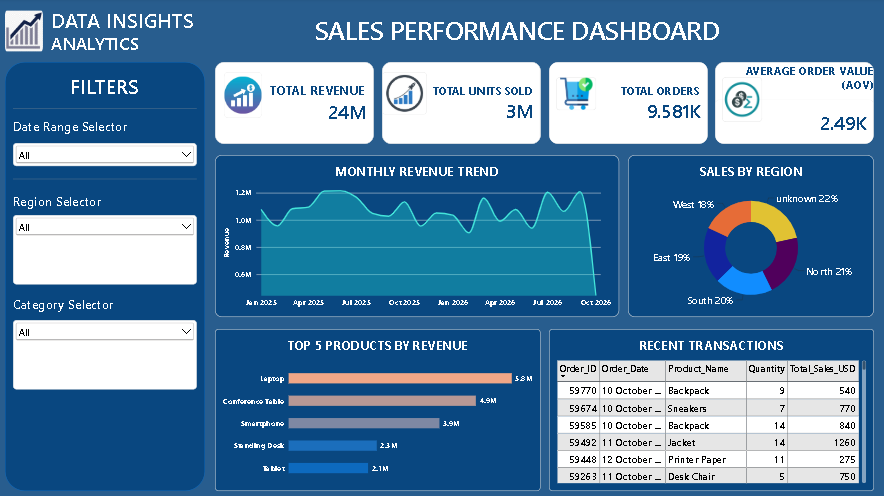

# Sales_Analysis
An end-to-end sales analytics portfolio project demonstrating data cleaning and querying via SQL, automated processing in Python, and executive-level visualization using Power BI to uncover revenue trends and KPI drivers.

# Sales Analytics Project

## Project Overview

This project focuses on analyzing sales data using SQL, Python, and Power BI to understand sales performance, identify trends, and generate meaningful business insights.

The main objective is to analyze revenue, product performance, regional sales, and monthly sales trends to support better business decision-making.

## Project Objectives

- Analyze overall sales and revenue performance.
- Identify top-performing products and categories.
- Understand regional sales performance.
- Analyze monthly sales trends.
- Identify missing values and data inconsistencies.
- Create an interactive Power BI dashboard.

## Tools & Technologies

- SQL
- Python
- Pandas
- NumPy
- Power BI
- Jupyter Notebook
- CSV Dataset

## Project Structure

- SALES_ANALYTICS.sql – SQL queries for data analysis.
- SalesAnalyticsipynb.ipynb – Python data analysis.
- sales_analytics.csv – Sales dataset.
- Powerbisales.pbix – Power BI dashboard.
- Salesdashboard.png – Dashboard screenshot.

## 1. SQL Analysis

SQL was used to perform data cleaning, validation, and business analysis.

### Key Tasks

1. Identified mismatched sales values.
2. Calculated monthly revenue and order counts.
3. Analyzed revenue and quantity by region and category.
4. Identified the top 3 products in each category.
5. Identified orders greater than twice the regional average.
6. Calculated category-wise revenue contribution.
7. Identified order frequency.
8. Checked NULL values.
9. Identified empty rows.
10. Updated missing values.

### SQL Concepts Used

- SELECT and WHERE
- GROUP BY and ORDER BY
- Aggregate Functions
- Subqueries
- Window Functions
- NULL Handling
- UPDATE Statements

## 2. Python Analysis

Python was used to analyze the sales dataset and answer important business questions.

### Business Questions

1. What is the total revenue and quantity of items sold across each region?
2. Which product categories and specific product names generate the highest total sales?
3. How do monthly sales trends fluctuate over time based on order dates?
4. What percentage of total orders contain missing values or data inconsistencies, and how were they cleaned?
5. Which region has the highest Average Order Value (AOV) per transaction?

### Python Libraries Used

- Pandas
- NumPy
- Matplotlib
- Seaborn

## 3. Power BI Dashboard

An interactive Power BI dashboard was created to visualize sales performance and business metrics.

### Key Performance Indicators (KPIs)

- Total Revenue
- Total Units Sold
- Total Orders
- Average Order Value (AOV)

### Dashboard Visualizations

- Monthly Revenue Trend
- Sales by Region
- Top 5 Products by Revenue
- Recent Transactions

## Dashboard Screenshot

## Key Business Insights

The analysis helps identify:

- Overall revenue and sales performance.
- Best-performing regions.
- Highest revenue-generating products.
- Monthly sales trends.
- Regional Average Order Value.

## Project Outcome

This project provided practical experience in:

- Data cleaning and preprocessing.
- SQL queries and business analysis.
- Python-based data analysis.
- Power BI dashboard development.
- Exploratory Data Analysis (EDA).
- Data visualization.
- Generating business insights.

## Skills Demonstrated

- Data Analytics
- SQL
- Python
- Power BI
- Data Cleaning
- Data Visualization
- Exploratory Data Analysis
- Business Intelligence
- Analytical Thinking

## Conclusion

This Sales Analytics project demonstrates my ability to work with sales data, perform data analysis using SQL and Python, and develop interactive dashboards using Power BI to generate meaningful business insights.
